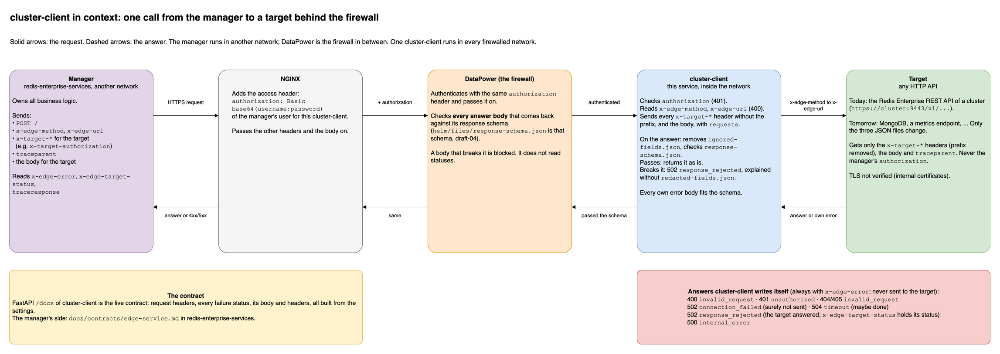
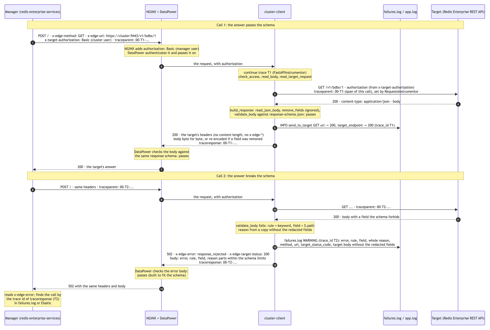
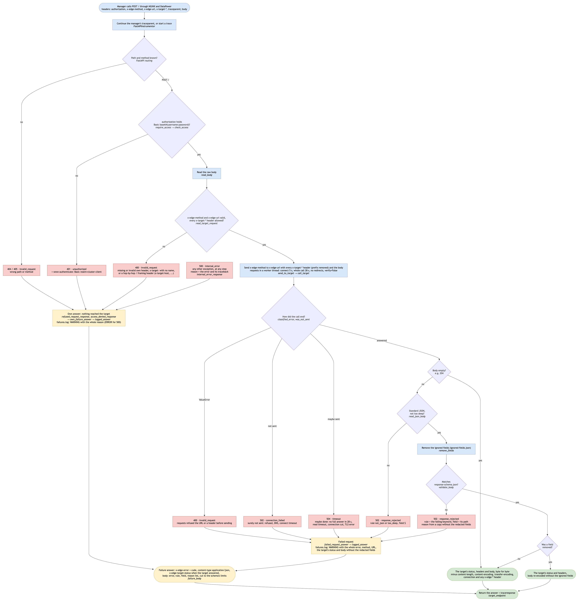
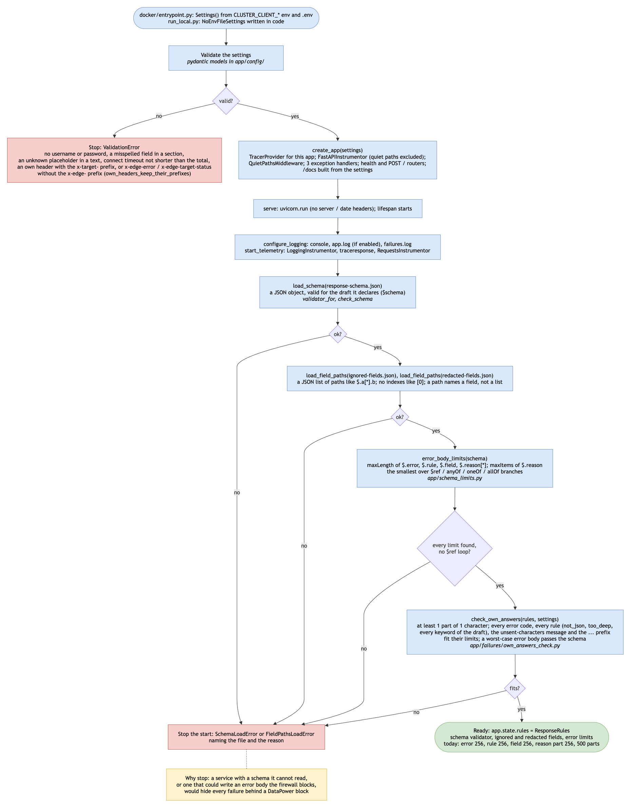
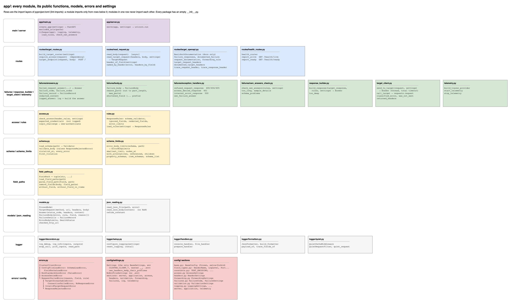

# Architecture

## The goal

cluster-client is a simple pipe across a firewall, simple on purpose. It is not tied to one technology: today the
target is the Redis Enterprise REST API of a cluster; tomorrow it can be MongoDB or a metrics endpoint, and only the
three JSON files in `helm/files/` change.

- It unpacks one request: `x-edge-method`, `x-edge-url`, and every `x-target-*` header, sent without the prefix.
- It sends that request to the target with `requests`.
- It returns the target's answer as it is, after three files:
  - `response-schema.json`: the DataPower firewall's own response schema. Every answer must match it.
  - `ignored-fields.json`: fields removed from every answer before the check.
  - `redacted-fields.json`: fields left out of a rejection's explanation and of the failure log.
- Anything the firewall would block, cluster-client rejects itself, with an explicit error that itself passes the
  firewall.
- It tells "surely not sent" apart from "maybe done".
- The manager owns all business logic. cluster-client never fixes or interprets an answer.
- FastAPI `/docs` is the live contract. It is built from the settings, so it always matches the running service.

## Context

The chain is: manager (redis-enterprise-services) → NGINX → DataPower → cluster-client → target.

| Part | Adds or checks |
|---|---|
| Manager | Sends `POST /` with `x-edge-method`, `x-edge-url`, `x-target-*` headers, `traceparent` and the body. Reads `x-edge-error`, `x-edge-target-status` and `traceresponse` |
| NGINX | Adds `authorization: Basic base64(username:password)` of the manager's user |
| DataPower | Authenticates with the same `authorization` and passes it on. Checks every answer body against its response schema and blocks one that breaks it |
| cluster-client | Checks `authorization`, sends the call, checks the answer against the same schema, writes the failure log |
| Target | Gets only the `x-target-*` headers (prefix removed), the body and `traceparent` |

## One call

The full flow, with every branch and failure, is in [failures.md](failures.md) and in this diagram:

Step by step (`app/routes/target_routes.py`, `target_endpoint`, is the orchestrator):

1. OpenTelemetry continues the manager's `traceparent`, or starts a trace (`FastAPIInstrumentor`, set up in
   `app/main.py`).
2. `require_access` checks `authorization` before the body is read (`app/access.py`). Wrong or missing: 401.
3. `read_body` reads the raw body. `read_target_request` (`app/routes/read_request.py`) builds a `TargetRequest`:
   method and URL from the own headers, every `x-target-*` header without the prefix. Invalid or refused: 400.
4. `send_to_target` (`app/target_client.py`) calls the target with `requests` in a worker thread and waits at most
   28 seconds for the whole call. No redirects are followed. TLS certificates are not checked (internal
   certificates). A failure is sorted into 400 (refused before sending), 502 `connection_failed` (surely not sent) or
   504 `timeout` (maybe done).
5. `build_response` (`app/response_builder.py`): an empty body is returned as is. Otherwise the body must be standard
   JSON, the ignored fields are removed (`app/field_paths.py`), and the rest must match the schema
   (`app/schema.py`). If it does, the target's answer is returned: byte for byte when nothing was removed,
   re-encoded otherwise. If not: 502 `response_rejected`.
6. Any failure of steps 4 and 5 goes to `failed_request_answer` (`app/failures/answers.py`): it writes the whole
   error to the failure file and builds the error body, cut to the schema's limits. Failures of steps 2 and 3, a
   wrong path or method, and any unexpected exception go through the exception handlers
   (`app/failures/exception_handlers.py`) to the same place.
7. The answer goes back with `traceresponse`.

What the target gets: the method and URL from the own headers (as `requests` sends them: the method in upper case,
the URL quoted again), every `x-target-*` header without the prefix, the body as is, and `traceparent`. Nothing else:
not `authorization` of the manager, not the headers NGINX, DataPower or the router add.

What the manager gets back on success: the target's status, headers and body. The headers leave out
`content-length`, `content-encoding`, `transfer-encoding`, `connection` (the server sets its own) and any `x-edge-*`
header, so a target can never fake `x-edge-error`.

## Startup

When the service starts it reads the three files and checks that it can do its job. It stops, instead of running,
when:

- a setting is missing or wrong (no username or password, a misspelled field, a wrong value);
- `response-schema.json` is not a valid JSON Schema for the draft it declares (draft-04 today);
- a field file is not a JSON list of field paths;
- the schema sets no limit for a field of the error body (`maxLength` of `error`, `rule`, `field`, each item of
  `reason`; `maxItems` of `reason`), or refers to itself;
- an error body the service could write would break the schema.

The reason: a service that cannot read the schema, or that could write an error body the firewall blocks, would turn
every failure into a DataPower block, and the manager would see nothing useful.

## Modules

The rows are the import layers enforced by `lint-imports` (`pyproject.toml`). A module imports only from the rows
below it. The full file map, with every function, is in [AGENTS.md](../AGENTS.md).

## Deployment

See [deployment.md](deployment.md).
