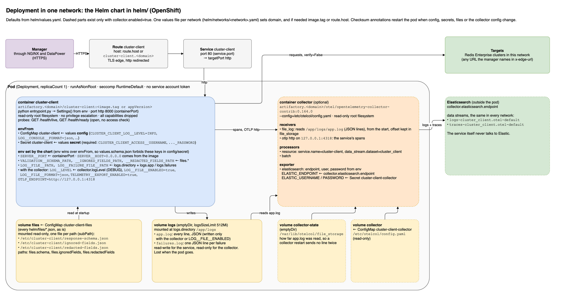

# Deployment

cluster-client runs on OpenShift, one release in every firewalled network. The chart is in `helm/`.



## Values

`helm/values.yaml` holds what every network shares. `helm/networks/<network>.yaml` holds only what differs: `domain`
(required), and if needed `image.tag` or `route.host`. `helm/values.schema.json` rejects an unknown key or a wrong
value, so `helm lint` and `helm install` fail early.

| Key | Default | Content |
|---|---|---|
| `domain` | `""` (required) | The network's domain. The suffix of the registry host and of the route host |
| `replicaCount` | `1` | |
| `image.registry`, `.repository`, `.tag`, `.pullPolicy` | `artifactory`, `cluster-client`, `""`, `IfNotPresent` | Image `<registry>.<domain>/<repository>:<tag>`; an empty tag is the chart's `appVersion` (`0.1.0`) |
| `containerPort` | `8000` | Also passed to the service as `CLUSTER_CLIENT_SERVER__PORT` |
| `service.port` | `80` | |
| `route.name`, `.host`, `.tls` | `cluster-client`, `""`, edge + Redirect | Host: `route.host`, else `<route.name>.<domain>` |
| `files.schema`, `.ignoredFields`, `.redactedFields` | `/etc/cluster-client/<file>.json` | Where each runtime file is mounted |
| `logs.directory`, `.app`, `.failures` | `/app/logs`, `app.log`, `failures.log` | The log folder (shared with the collector) and the file names |
| `logsSizeLimit` | `512Mi` | Size limit of the logs `emptyDir` |
| `config` | log level INFO, console JSON, DEBUG file off, failure file on | `CLUSTER_CLIENT_*` variables (strings) → ConfigMap |
| `secret` | `{}` | `CLUSTER_CLIENT_*` variables → Secret. Must hold `CLUSTER_CLIENT_ACCESS__USERNAME` and `CLUSTER_CLIENT_ACCESS__PASSWORD`. Pass them with `--set`, never in a file in git |
| `collector.*` | off | The OpenTelemetry Collector sidecar, see below |
| `resources` | requests 100m / 128Mi, limit 256Mi | |

`config` and `secret` keys must match `CLUSTER_CLIENT_[A-Z0-9_]+`. Seven keys are refused there, because the image or
the chart sets them and a value in `config` would be overwritten without a word (`env` wins over `envFrom`):
`SERVER__HOST`, `SERVER__PORT`, `VALIDATION__SCHEMA_PATH`, `VALIDATION__IGNORED_FIELDS_PATH`,
`VALIDATION__REDACTED_FIELDS_PATH`, `LOG__FILE__PATH`, `LOG__FAILURE_FILE__PATH` (all with the `CLUSTER_CLIENT_`
prefix). Every other setting is listed in [configuration.md](configuration.md); the service checks the values when it
starts.

## What the chart creates

| Object | Name | Content |
|---|---|---|
| Deployment | `cluster-client` | The pod below |
| Service | `cluster-client` | Port `service.port` → the container port |
| Route | `cluster-client` | The manager's address, TLS edge |
| ConfigMap | `cluster-client` | `config`, as environment |
| Secret | `cluster-client` | `secret`, as environment (only when `secret` is not empty) |
| ConfigMap | `cluster-client-files` | The three runtime files from `helm/files/`, as they are; a missing one fails the render |
| ConfigMap | `cluster-client-collector` | The collector's `config.yaml` (collector only) |
| Secret | `cluster-client-collector` | The Elastic username and password (collector only) |

(The names assume the release is called `cluster-client`.)

The pod has checksum annotations of both ConfigMaps, both Secrets and the files. A change to any of them restarts it on
`helm upgrade`.

## The pod

**Container `cluster-client`**: runs `python entrypoint.py` (`docker/entrypoint.py`), which reads every setting from
the environment. Non-root, read-only root filesystem, no privilege escalation, all capabilities dropped, no service
account token. Probes: `GET /health/live` and `GET /health/ready` (both answer `{"status": "up"}` and need no
credentials).

Environment, in this order (a later one wins):

1. The image (`docker/Dockerfile`): `SERVER__HOST=0.0.0.0`, `SERVER__PORT=8000`, the three file paths under
   `/etc/cluster-client/`, the two log paths under `/app/logs/`.
2. `envFrom`: the ConfigMap (`config`) and the Secret (`secret`).
3. `env` set by the chart: `SERVER__PORT` from `containerPort`, the three file paths from `files.*`, the two log
   paths from `logs.*`.
4. With the collector also: `LOG__LEVEL` from `collector.logLevel` (DEBUG), `LOG__FILE__ENABLED=true`,
   `LOG__FILE__FORMAT=json`, `TELEMETRY__EXPORT_ENABLED=true`, `TELEMETRY__OTLP_ENDPOINT=http://127.0.0.1:4318`.

**Volumes**:

| Volume | Source | Mounted in | Content |
|---|---|---|---|
| `files` | ConfigMap `cluster-client-files` | the service, read-only, one `subPath` per file at `files.schema`, `files.ignoredFields`, `files.redactedFields` | The three runtime files |
| `logs` | `emptyDir` (`logsSizeLimit`) | the service at `logs.directory`; the collector read-only | `app.log`, `failures.log`. Lost with the pod |
| `collector` | ConfigMap `cluster-client-collector` | the collector at `/etc/otelcol` | `config.yaml` |
| `collector-state` | `emptyDir` | the collector at `/var/lib/otelcol/file_storage` | How far `app.log` was read |

## The three runtime files

`response-schema.json`, `ignored-fields.json` and `redacted-fields.json` live only in `helm/files/`. They are never
built into the image. The local run and the tests read the same files. To change one: edit it in `helm/files/` and
run `helm upgrade`; the pod restarts with it. If a file is wrong, the pod does not start, and its log says which file
and why.

## Logs and traces to Elastic

The service never talks to Elastic. With `collector.enabled=true` the chart adds an OpenTelemetry Collector container
(`otel/opentelemetry-collector-contrib`, `collector.image.tag` 0.164.0, pulled from the same registry:
`<image.registry>.<domain>/<collector.image.repository>`):

- **logs**: the service writes every line at `collector.logLevel` (default DEBUG, passwords included) as JSON to
  `<logs.directory>/<logs.app>`. The collector's `file_log` receiver reads it from the start and remembers its
  position in `collector-state`, so a collector restart sends no line twice. `failures.log` is not read; its lines are
  also in `app.log`.
- **traces**: the service sends its spans over OTLP/HTTP to `127.0.0.1:4318`.
- Both get `service.name=cluster-client` and `data_stream.dataset=cluster_client`, and go to Elasticsearch
  (`collector.elasticsearch.endpoint`) with the collector's own username and password (Secret
  `cluster-client-collector`). They land in the data streams `logs-cluster_client.otel-default` and
  `traces-cluster_client.otel-default`, the same in every network. The Elastic user needs to write to them.
- `collector.elasticsearch.insecureSkipVerify` turns off the TLS check to Elastic (default `false`).

With the collector on, `endpoint`, `username` and `password` are required.

## Commands

```bash
helm lint helm -f helm/networks/<network>.yaml \
  --set secret.CLUSTER_CLIENT_ACCESS__USERNAME=<manager user> \
  --set secret.CLUSTER_CLIENT_ACCESS__PASSWORD="$MANAGER_PASSWORD"

helm template cluster-client helm -f helm/networks/<network>.yaml \
  --set secret.CLUSTER_CLIENT_ACCESS__USERNAME=<manager user> \
  --set secret.CLUSTER_CLIENT_ACCESS__PASSWORD="$MANAGER_PASSWORD"

helm upgrade --install cluster-client helm -f helm/networks/<network>.yaml \
  --set secret.CLUSTER_CLIENT_ACCESS__USERNAME=<manager user> \
  --set secret.CLUSTER_CLIENT_ACCESS__PASSWORD="$MANAGER_PASSWORD"
```

With the collector:

```bash
helm upgrade --install cluster-client helm -f helm/networks/<network>.yaml \
  --set secret.CLUSTER_CLIENT_ACCESS__USERNAME=<manager user> \
  --set secret.CLUSTER_CLIENT_ACCESS__PASSWORD="$MANAGER_PASSWORD" \
  --set collector.enabled=true \
  --set collector.elasticsearch.endpoint=https://elastic.<domain>:9200 \
  --set collector.elasticsearch.username=<elastic user> \
  --set collector.elasticsearch.password="$ELASTIC_PASSWORD"
```

The manager's address is the Route's host:

```bash
oc get route cluster-client -o jsonpath='{.spec.host}'
```

## A new network

1. Create `helm/networks/<network>.yaml` with `domain: <the network's domain>` (see `helm/networks/example.yaml`).
2. Push the image to `artifactory.<domain>/cluster-client:<tag>` (and the collector image, if used).
3. Run the `helm upgrade --install` above.
4. Give the manager the Route's host and the username and password.
