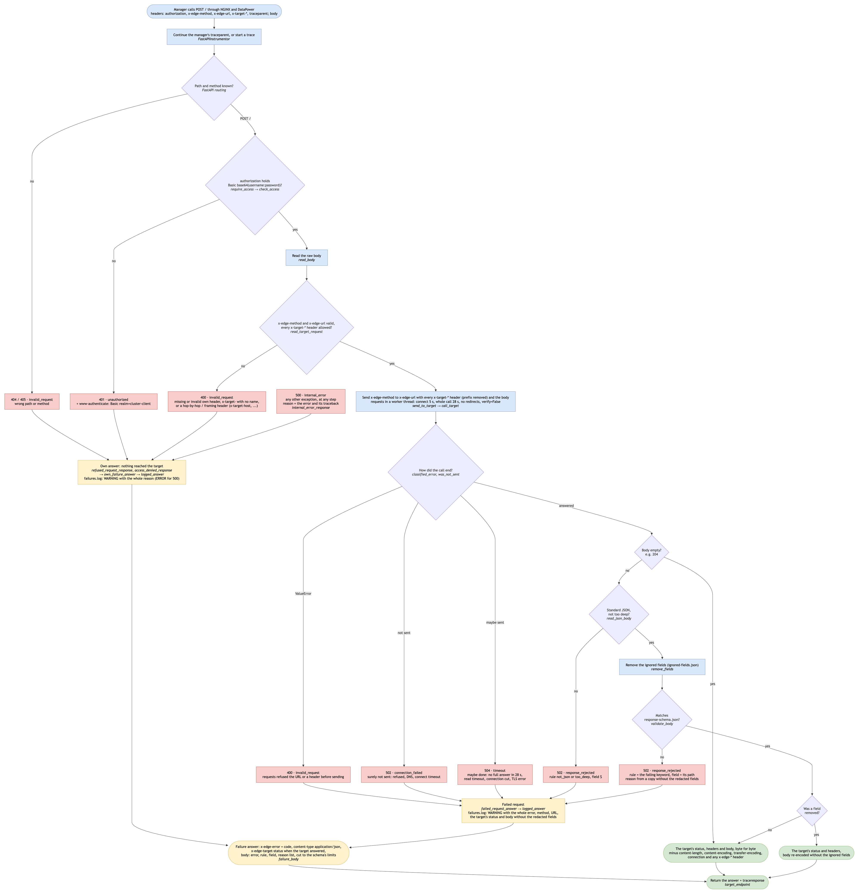

# Failures

Every answer cluster-client writes itself has the header `x-edge-error`. A target's own answer never has it:
cluster-client drops any `x-edge-*` header the target sends. So the manager can always tell the two apart.



## Every failure

Status codes, error codes and header names are the defaults. Each can be changed in `CLUSTER_CLIENT_FAILURES__*`
(see [configuration.md](configuration.md)).

| Status | `x-edge-error` | When | Reached the target? | Extra headers | What it means for the manager |
|---|---|---|---|---|---|
| 401 | `unauthorized` | `authorization` is missing, not `Basic`, or not the configured username and password. Checked before the body is read. | No | `www-authenticate: Basic realm="cluster-client"` | Fix the credentials NGINX adds. Retrying the same call does not help. |
| 400 | `invalid_request` | `x-edge-method` or `x-edge-url` is missing or invalid (the method must be an HTTP token, the URL an http or https URL). The `reason` is the list of refusals as JSON. | No | | A bug in the request. Fix it; do not retry. |
| 400 | `invalid_request` | A header is exactly `x-target-` (no name), or names a hop-by-hop or framing header: `x-target-connection`, `-content-length`, `-host`, `-keep-alive`, `-proxy-authenticate`, `-proxy-authorization`, `-proxy-connection`, `-te`, `-trailer`, `-transfer-encoding`, `-upgrade`. | No | | A bug in the request. Fix it; do not retry. |
| 400 | `invalid_request` | `requests` refused the URL or a header before sending (any `requests` error that is also a `ValueError`). | No | | A bug in the request. Fix it; do not retry. |
| 404 | `invalid_request` | Wrong path on cluster-client (only `POST /`, `/health/live`, `/health/ready` and FastAPI's `/docs`, `/redoc`, `/openapi.json` exist). | No | | Wrong cluster-client URL. |
| 405 | `invalid_request` | Wrong method, e.g. `GET /`. | No | `allow: POST` | Use `POST /`. |
| 502 | `connection_failed` | The call surely did not leave: connection refused, DNS failure, connect timeout (`connect_timeout_seconds`, 5). | No | | Safe to retry later. The target, or the way to it, is down. |
| 504 | `timeout` | The call may have reached the target, but no full answer came: no answer within `timeout_seconds` (28) for the whole call, read timeout, connection cut, any TLS error. | Maybe | | The operation may have happened. Check the target's state before you repeat a change. |
| 502 | `response_rejected` | The target answered, but its body would be blocked by the firewall: not JSON (also `NaN`, `Infinity`), nested too deeply to check, or breaks `response-schema.json`. | Yes, and it answered | `x-edge-target-status: <the target's status>` | The target did the work (if any). Its status is in `x-edge-target-status`; the body is held back. Read the failure file by trace id. If the answer is legitimate, the schema or the ignored fields must change. |
| 500 | `internal_error` | Any other exception inside cluster-client. | Unknown | | A bug in cluster-client. Treat it like `timeout`. |

Notes:

- A target error is not a cluster-client error. A target that answers `404` with a JSON body that passes the schema is
  returned as is: status 404, no `x-edge-error`.
- A target answer with an empty body (for example `204`) is returned as is, without any check.
- A target answer that is not JSON (an HTML error page, for example) is rejected like any other body:
  `502 response_rejected`, `rule: not_json`, and `x-edge-target-status` holds the target's status.
- Only one refusal is reported at a time: a missing own header is reported before a refused `x-target-*` header.

## The error body

Every failure answer has `content-type: application/json` and this body:

```json
{"error": "response_rejected", "rule": "additionalProperties", "field": "$", "reason": ["'bad key' does not match any of the regexes: ..."]}
```

| Field | Content | On |
|---|---|---|
| `error` | The error code, the same as `x-edge-error`. | Every failure |
| `rule` | The JSON Schema keyword that failed (`type`, `maxLength`, `anyOf`, ...), or `not_json`, or `too_deep`. | `response_rejected` only |
| `field` | The failing field as a path (`$`, `$.uid`, `$[3].name`). A path longer than the schema allows is cut from the start and begins with `...`. | `response_rejected` only |
| `reason` | The explanation, in parts. Joined, the parts are the whole text. | Every failure |

The body itself must pass the firewall, so its limits come from `response-schema.json` at startup:

- each part of `reason` is at most the `maxLength` of `$.reason[*]` (256 today);
- `reason` has at most the `maxItems` of `$.reason` (500 today); when the text is longer, the last part says how many
  characters were not sent (`{count} more characters were not sent`);
- `field` is at most the `maxLength` of `$.field` (256 today), `...` included.

The `reason` of each failure:

| Failure | `reason` |
|---|---|
| `unauthorized` | `the authorization header is missing or does not hold the expected credentials` |
| `invalid_request` (own headers) | the validation errors, with the header name in `loc`, e.g. `[{'type': 'missing', 'loc': ('x-edge-url',), 'msg': 'Field required'}]` |
| `invalid_request` (refused headers) | `x-target-host: nameless, hop-by-hop and framing headers are never sent to the target` |
| `invalid_request` (before sending) | `cannot send to <url>: <the requests error>` |
| `invalid_request` (404, 405) | `Not Found`, `Method Not Allowed` |
| `connection_failed`, `timeout` | `cannot reach <url>: <the requests error>`, or `no full answer within 28.0 seconds` |
| `response_rejected` | `the response body is not JSON: <error>`, `the response body is nested too deeply to be checked`, or the schema's message |
| `internal_error` | the error and its whole traceback |

### Passwords in a rejection

When the body breaks the schema, `rule` and `field` come from the real failure. `reason` is built again from a copy of
the body without the fields in `redacted-fields.json` (the passwords Redis returns in bdb and crdb answers):

- if the copy fails at the same path, `reason` is that failure's message, without the passwords;
- if not (for example, the failing value is itself a password), `reason` is
  `the failing value is a redacted field`.

A secret that is not listed in `redacted-fields.json` goes out in full. This is deliberate: the explanation reaching
the manager comes first. The original message, with the password, is written only to the DEBUG log.

## Where each failure is written

| Where | What |
|---|---|
| Failure file `logs/failures.log` (logger `cluster_client.failures`) | One JSON line per failure, never cut: `error`, `rule`, `field`, the whole `reason`. For a failed call to the target also `method`, `url`, `target_status_code` and `target_response` (the target's body without the redacted fields; a body that is not JSON is written as it is). Level WARNING, ERROR for `internal_error`. |
| Terminal, and `logs/app.log` when it is on | The same line (the failure logger passes its records on to the main handlers). |
| DEBUG log (`logs/app.log` with `CLUSTER_CLIENT_LOG__LEVEL=DEBUG`) | Every function's arguments and result, the target's password and the original schema message included. |
| Elastic | `app.log`, when the Helm collector is on (see [deployment.md](deployment.md)). |

Every line carries the `trace_id` of the call. The answer's `traceresponse` header holds the same id
(`00-<trace_id>-<span_id>-<flags>`), so a failure is found by it:

```bash
grep '"trace_id": "0af7651916cd43dd8448eb211c80319c"' logs/failures.log
```
